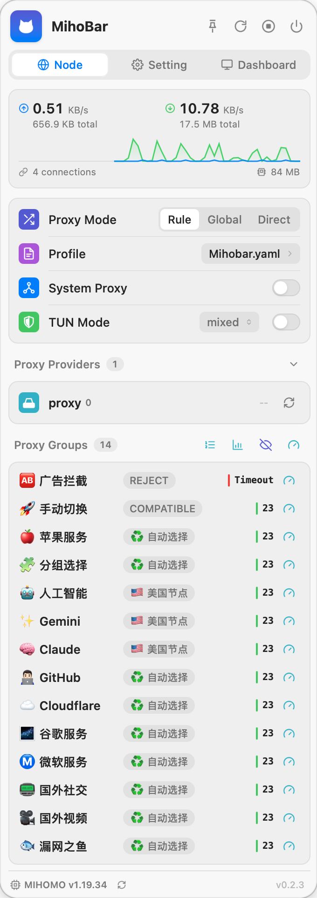
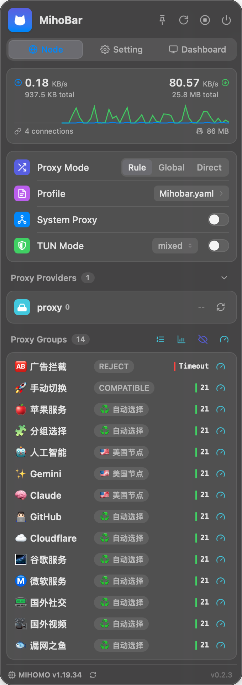
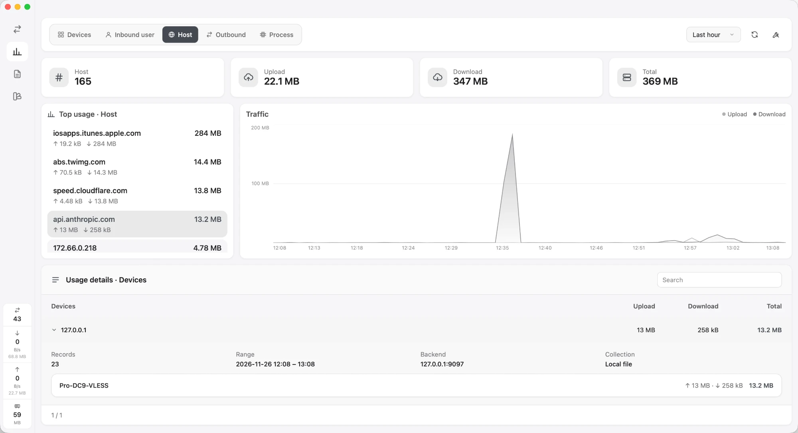

<div align="center">


# MihoBar

A lightweight, native macOS menu bar client for [mihomo](https://github.com/MetaCubeX/mihomo),
written in Rust on [NSH](https://nsh.dev).<br/>
A lean panel for everyday switching, and a full dashboard only when you need it.

<p>
  
  
  
  
  <a href="https://github.com/leeechsh/MihoBar/releases/latest"></a>
  <a href="https://github.com/leeechsh/MihoBar/releases"></a>
  <a href="./LICENSE"></a>
</p>

<p>
  📦 <a href="https://github.com/leeechsh/MihoBar/releases/latest"><strong>Download</strong></a>
  ·
  🐛 <a href="https://github.com/leeechsh/MihoBar/issues"><strong>Issues</strong></a>
</p>

</div>

<p align="center">
  
  &nbsp;
  
</p>

## ✨ Why MihoBar

- 🪶 **Light on memory.** A native Rust app with no web view and no runtime to
  carry: the menu bar app sits at about **40 MB**. Views are built when the
  panel opens and dropped when it closes.
- 🧭 **A lean panel.** Proxy mode, profile, system proxy, TUN and your proxy
  groups (with latency tests) on the first tab; every setting on the second.
  Nothing you only need once a week.
- 📊 **A full dashboard, only while it's open.** Connections, usage, logs and
  rules, in the style of [metacubexd](https://github.com/MetaCubeX/metacubexd) /
  [zashboard](https://github.com/leeechsh/zashboard). It runs as its **own
  process**: closing the window gives all of its memory back.
- 📈 **Usage history, kept locally.** Traffic by device, host, outbound,
  process and inbound user, recorded on your Mac (a month by default), with
  no browser storage and no cloud.
- 🔄 **Updates itself, safely.** MihoBar updates from GitHub Releases, with a
  signed manifest and checksummed downloads; the mihomo core can update
  itself too. Turn either off in one menu.
- 🔐 **System integration.** System proxy through a small Rust helper, TUN
  mode, start at login, subscriptions, Wi-Fi–based profile switching, and
  automatic stop/start when the network drops and returns.
- 🌍 **English and Simplified Chinese**, following your system language by
  default, in light and dark mode.

### 📏 Memory (measured on the author's Mac)

| App process (core not included) | Memory |
| ------------------------------- | -----: |
| **MihoBar**, panel              | ~40 MB |
| MihoBar dashboard, while open   | ~45 MB, freed on close |
| ClashBar                        | ~80–90 MB |

Numbers are `phys_footprint` (what Activity Monitor shows) for the app's own
process; the mihomo core is a separate process in every client. Your numbers
will vary with your profile and the number of connections.

### 📈 Usage statistics, on your Mac

See where your traffic goes: by **device**, **inbound user**, **host**,
**outbound** or **process**, over the last hour, day, week or month. A chart
of traffic over time, the top consumers, and details you can expand down to
the proxy each connection used. MihoBar records usage itself, in a few small
files in its data folder (kept a month by default), so the history is there
whenever you open the Dashboard: no browser tab to keep open, nothing sent
anywhere.

<p align="center">
  
</p>

## 📦 Install

**Requires** macOS 14 or later, on Apple silicon or Intel.

1. Download the `.dmg` for your Mac from
   [Releases](https://github.com/leeechsh/MihoBar/releases/latest):
   `MihoBar-<version>-macos-aarch64.dmg` (Apple silicon) or
   `MihoBar-<version>-macos-x86_64.dmg` (Intel).
2. Open it and drag **MihoBar** into **Applications**. Run it from there: the
   system proxy helper only installs from `/Applications`.
3. MihoBar is not signed with an Apple Developer ID yet, so macOS blocks its
   first launch. Open it once from **System Settings → Privacy & Security →
   Open Anyway**, or clear the quarantine flag:

   ```bash
   xattr -dr com.apple.quarantine /Applications/MihoBar.app
   ```

> [!IMPORTANT]
>
> - Let only one mihomo / Clash client control the system proxy at a time.
> - The first time you turn on **System Proxy** or **TUN Mode**, macOS asks
>   for an administrator password: MihoBar installs its helper, or gives the
>   core the permission TUN needs.
> - After an in-app update, macOS may ask again for permissions such as
>   location (used only by Wi-Fi profile switching), because the app is
>   signed ad hoc.

## 🚀 Quick start

1. Click the cat in the menu bar to open the panel.
2. Import a **Profile**: a local file or a subscription link (MihoBar ships
   none, so it starts from yours).
3. Press **▶** to start the core.
4. Choose a **Proxy Mode**: Rule, Global or Direct.
5. Pick nodes in your proxy groups and test their latency, then turn on
   **System Proxy** (or **TUN Mode** for apps that ignore it).

## 🗺️ Features

| Where | What |
| ----- | ---- |
| 🧭 **Node** tab | Traffic and connections at a glance, proxy mode, profile, system proxy, TUN (with its stack), proxy providers, proxy groups with latency tests, sorting and hidden groups |
| ⚙️ **Setting** tab | Start at login, auto start, menu bar style (icon, speed, or both), language, appearance, log level, auto update, proxy bypass, core settings (allow LAN, IPv6, TCP concurrent), ports, terminal proxy, maintenance (flush caches, update GeoIP / GeoSite) |
| 🌐 Dashboard: **Connections** | Live connections with chosen columns, sorting, grouping, regex search and hiding, details, pause, close |
| 📈 Dashboard: **Usage** | Traffic by device, inbound user, host, outbound or process over a time range, with a chart and details |
| 🪵 Dashboard: **Logs** | MihoBar's and the core's logs together, with history; filter by source, level and type; regex search; download |
| 📚 Dashboard: **Rules** | Rules with hits and their proxy chains, a switch for each rule, rule providers |
| 🦶 Panel footer | MihoBar's and the core's versions: check and update both in place |

📁 Data lives in `~/Library/Application Support/mihobar` (profiles in
`config/`, the core in `core/mihomo`, logs in `logs/`, usage in `usage/`).

## 🔄 Updates

- **Settings → Auto Update** ticks **App** and **Core** separately.
  - **App** ticked: MihoBar checks at launch and daily, and offers new versions
    with their release notes.
  - **Core** ticked: newer mihomo versions install by themselves (except while
    TUN is on, which needs the core's permission).
- The **panel footer** checks and updates either one by hand, and shows the
  result in place.
- App updates come from this repository's releases. MihoBar verifies a signed
  `latest.json` and each download's SHA-256 before it replaces itself.

## 🛠️ Development

Building needs Rust and the [NSH](https://nsh.dev) CLI 0.7
(`curl -fsSL https://nsh.dev/install.sh | sh`).

```bash
scripts/package.sh    # .nsh/out/MihoBar.app, with the mihomo core and the privileged helper
scripts/test.sh       # unit tests and UI tests (headless), in a fresh data directory
```

<details>
<summary><strong>Packaging, the helper and TUN</strong></summary>

`scripts/package.sh` fetches the mihomo core if needed
(`scripts/fetch-mihomo.sh`), runs `nsh package --target macos`, builds the
helper (`helper/`), puts it in `Contents/Library/HelperTools` with its
launchd plist, and signs both ad hoc (`dev.mihobar.helper`,
`dev.mihobar.app`; set `SIGN_IDENTITY` for a Developer ID).

The system proxy is set by a root helper
(`/Library/PrivilegedHelperTools/dev.mihobar.helper`, a launchd XPC service
that only answers `dev.mihobar.app`); TUN runs the core setuid root. To
remove the helper:

```bash
sudo launchctl bootout system/dev.mihobar.helper; sudo rm -f /Library/LaunchDaemons/dev.mihobar.helper.plist /Library/PrivilegedHelperTools/dev.mihobar.helper*
```

</details>

<details>
<summary><strong>Tests</strong></summary>

`scripts/test.sh` runs `nsh test` with `MIHOBAR_HOME` set to a fresh
directory, so your data directory is never touched. Tests that start a core
use the controller `127.0.0.1:9097` and mixed port 7897, so the script
refuses to run while another MihoBar holds those ports. The subscription test
downloads `http://127.0.0.1:8765/sub.yaml`: serve a mihomo config under that
name first, for example

```bash
python3 -m http.server 8765 --bind 127.0.0.1 --directory path/to/dir-with-sub.yaml
```

</details>

<details>
<summary><strong>Releases</strong></summary>

`.github/workflows/release.yml` builds on GitHub's macOS runners (Apple
silicon and Intel) with the mihomo core for each (the repository variable
`MIHOMO_VERSION` pins one), and publishes a `.dmg`, a `.zip`, their SHA-256
sums, and `latest.json` signed with the `NSH_UPDATER_KEY` secret. Bump
`version` in `nsh.json` and `Cargo.toml`, then push a tag whose message
carries the release notes (Markdown; keep `#` headings with
`--cleanup=verbatim`):

```bash
git tag -a v0.2.4 --cleanup=verbatim -F notes.md && git push origin v0.2.4
```

Running the workflow by hand replaces the `alpha` pre-release instead.

</details>

<details>
<summary><strong>How the dashboard and usage work</strong></summary>

In the app bundle, the dashboard is a process of its own, started by the
panel (`MIHOBAR_ADVANCED` names its first page) and reading the same core;
closing its window ends the process. Outside a bundle (development, tests) it
opens in the panel's process. Its settings are kept in `state/advanced.json`.

Usage is counted by the menu bar process whenever the core runs: it reads the
core's connections every 5 s (every second while something shows them), adds
each connection's traffic to per-minute buckets and appends them to
`usage/YYYY-MM-DD.tsv`. Days older than two are folded into hourly buckets,
and days past the retention period (a month by default) are deleted.

</details>

### Known limitations

- Ad hoc signed: no Developer ID or notarization yet (see Install). A
  Developer ID build should also pin the helper's client requirement to its
  Team ID.
- Not yet: keyboard shortcuts, a web UI button, refreshing all providers at
  startup.

## 🙏 Acknowledgements

- [ClashBar](https://github.com/Sitoi/ClashBar) by Sitoi, whose ideas and
  design MihoBar draws on. MihoBar's localized strings come from ClashBar
  (v0.3.6, GPL-3.0).
- [MetaCubeX/mihomo](https://github.com/MetaCubeX/mihomo) for the core.
- [NSH](https://nsh.dev), the native UI framework MihoBar is built with.
- [metacubexd](https://github.com/MetaCubeX/metacubexd) and
  [zashboard](https://github.com/leeechsh/zashboard), the dashboards the
  Dashboard window follows.

## 📄 License

MihoBar is licensed under the **GNU General Public License v3.0**, like
ClashBar. See [LICENSE](./LICENSE).
